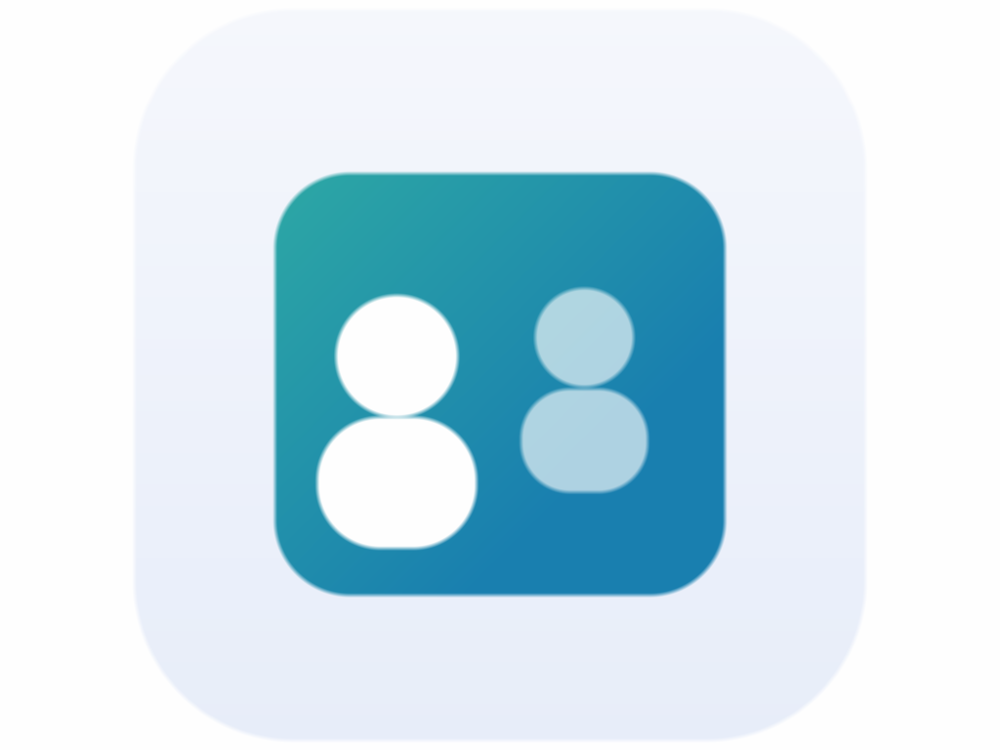

# Lv Contacts (小驴人脉)

**Manage people, relationships, organizations, and milestones in SiYuan: person records are documents backed by a native SiYuan database.**

**Latest stable release: v0.7.10** · [Download and install](https://github.com/xiaolv-suite/siyuan-contacts/releases/tag/v0.7.10) · [Open an issue](https://github.com/xiaolv-suite/siyuan-contacts/issues)

English | [简体中文](README.md)

---

## 🎯 What Problem Does Lv Contacts Solve?

Personal connections are often fragmented across phone address books, chat remarks, and scattered meeting notes — making it easy to forget what you last discussed, who introduced whom, dietary taboos before a dinner, or when an important relationship has quietly gone cold.

**Lv Contacts** brings Local-First Personal Relationship Management (PRM) natively into SiYuan Note:
- **One Person, One Document**: Every contact is both a native SiYuan document and a structured Attribute View database row, keeping 100% of your data local.
- **Anti-Drift Relationship Temperature**: Tiered contact cadences (14/30/90/180 days) automatically track warmth and highlight overdue connections.
- **30-Second Pre-Meeting Brief**: One collapsible card summarizes last conversation, how you met & introducer, preferences/taboos, and shared acquaintances.
- **Visual Relationship & Organization Graph**: Dual-mode network graph (explicit relations, directed introducer links, co-attendance + native document backlinks) and multi-tenure organization history.

---

## 💡 Key Features & Capabilities

Lv Contacts is a **Local-First**, **privacy-centric**, and **bi-directionally linked** Personal Relationship Management (PRM) platform. Unlike sales-oriented corporate CRMs, Lv Contacts is built for nurturing authentic, long-term personal ties, relationship temperature tracking, mutual exchanges, and milestone memories.

| Category | Purpose & Value | Key Capabilities |
| :--- | :--- | :--- |
| **📇 Universal Person Dossier (One Person, One Document)** | Each person corresponds to a native SiYuan document backed by a native database row — both structured roster and rich personal journal. | • Native Attribute View database backbone • Name, phone, WeChat, email, website, city, birthday (Gregorian/Lunar auto-conversion) • Privacy Shield (1-click mask for sensitive contacts with 5-sec temporary reveal) • Squircle multi-color initials avatar spectrum & Pinyin index |
| **🌡️ Cadence & Relationship Temperature** | Moving past mechanical reminders to objectively calculated relationship temperatures, preventing connections from slipping away unnoticed. | • 4-tier dynamic temperature: 🔥 Hot (frequently contacted) / 🍃 Warm (healthy) / 🌬️ Cool (mildly overdue) / ❄️ Cold (distant) • Custom cadence intervals (1–365 days) or pause snooze • Home "Cooling Radar & Reconnect Hub" console with star VIP weighting and 1-click drilldown |
| **💬 Interactions & Scene Templates** | Conversational timeline tracking with contextual variables, extracting insights directly from your discussions. | • Bubble interaction timeline distinguishing visits, coffee, meals, calls, chat, and meetings • 9 curated scenario templates (business visit, coffee chat, banquet dinner, forums, consultations, etc.) • Dynamic variables (`{{name}}`, `{{date}}`, `{{lastContact}}`, `{{company}}`, `{{role}}`, `{{city}}`) • Automatic fact extraction: quotes, preferences, and verified facts |
| **🗓️ Itineraries & Visit Preparation** | Designed for appointments, travel, and meetings, ensuring you arrive well-prepared and follow up without re-typing. | • Structured agenda, time, venue, companions, and checklist items • Interactive preparation checklist (documents, samples, gifts) with checkmarks • Countdown badges (Today / N days away / Overdue) • 1-click "Fulfill and Log Interaction" to append minutes into timeline; 1-click Markdown copy |
| **🛡️ Preferences & Dietary Taboos** | Record genuine dietary habits and taboos directly inside the person's SiYuan document to avoid missteps when hosting or meeting. | • Native person-document facts block supporting preferences & `🚫 Taboo Red Lines` • Header "Micro-Preferences Ribbon" and 30-Second Pre-Meeting Brief automatically surface red-line alerts • Home "Pre-Meeting Hub & Taboo Radar" to audit taboos across all contacts |
| **⚖️ Bilateral Promises & Favor Ledger** | Keep factual records of mutual commitments and gift/favor exchanges. | • Bilateral commitments: track my promises vs. their promises and fulfillment dates • Gift & favor ledger: transparent tracking of favors and settlement status |
| **🌐 Network Graph & Hubs Analysis** | Visualizing complex social connections and identifying central hubs and bridge connectors across circles. | • Dual modes: explicit relations graph + native SiYuan document reference graph • 4 layout engines: CoSE, Concentric, Breadthfirst, Circle • Timeline growth slider replaying network evolution over the years • "Network Hubs & Bridge Connectors" modal identifying degree hubs and cross-circle bridges |
| **📜 Chronicles & Milestone Documents** | Archiving shared history and milestones into lifelong digital records. | • Longitudinal milestones chronicle tracking first acquaintance, stage shifts, and fulfilled promises • 1-click export to native SiYuan document (`/人脉回顾/📜 人脉交往编年史 · Name`) and Markdown • Header "Anniversary Milestones Banner" celebrating N-year milestones with ready-to-use greeting copy • Standard RFC 5545 iCalendar (`.ics`) export for all anniversaries and birthdays |
| **🎴 Business Card Posters & Riff Flashcards** | Sharable vector business cards and spaced-repetition flashcards for cognitive retention. | • Pure SVG vector business card posters (horizontal 600x380 / vertical 440x600, 3 luxury themes) • 1-click generation of native SiYuan Riff Q&A flashcards for FSRS spaced-repetition review |
| **👥 Organizations & Family Kinship Tree** | Mapping institutional coordinates and family bonds. | • Institutional rosters and multi-tenure member career history • 5-generation family kinship tree (elders, spouse, siblings, children, relatives) with 1-click document links |
| **🎪 Group Occasions & Gatherings Hub** | Connecting multi-attendee gatherings to individual dossiers. | • Reverse-chronological timeline of seminars, dinners, weddings, salons, and summits • Metrics on total occasions, cumulative attendees, and linked notes • Attendee avatar ribbons with 1-click "Roster Drilldown" to filter attendee contacts |
| **🗑️ Roster Soft-Delete Trash Bin** | 30-day safety buffer preventing irreversible accidental deletions. | • Card roster displaying deleted contact name, phone, group, and tags snapshot • Real-time countdown (`N days remaining`, red warning for ≤3 days) • 1-click restoration to database and roster; permanent purge confirmation |
| **🧹 Advanced Filters, Tidy Drawer & Export** | High-volume contact management and clean local interoperability. | • Multi-dimensional filters (temperature, stage, region, organization, data gaps) with saved views • "Tidy Drawer" recommending groups and inferred tags for unorganized contacts • UTF-8 BOM CSV export and formatted Markdown roster tables • vCard 2.1/3.0/4.0 import & vCard 3.0 export |
| **🔒 Local-First & Lossless Migration** | True data sovereignty: zero cloud dependency, zero data leaks, full backup. | • 100% stored in local SiYuan workspace, zero telemetry, zero external network requests • Web Lock concurrency protection with double read-after-write verification • Complete 24-module migration bundle (export, preview, current-first merge) |

---

## 📝 Recent Updates

- **SiYuan 3.8.10+ Native Adaptations**: Contact detail avatar supports right-click `openNativeAssetPicker` to select workspace assets; robust avatar URL resolution (`resolveAvatarUrl`) for both relative paths and DataURLs; relation graph drawer and org docs support native document tree context menus; half-width slash title protection (`safeDocTitleFromHPath`).
- **Input Method & Keyboard Defense**: All 16 search/input handlers (dual-end search boxes, person picker, aliases, relation labels, quick memo, org rename, and 7 detail-view inputs) yield during IME composition to prevent premature submission; 4 `role="button"` elements gained Enter/Space keyboard activation; graph legend items announce `aria-pressed`.
- **Responsive & Visual Polish**: Mobile workbench bottom whitespace reduced by 20px aligned with 64px nav + safe area; search inputs standardized to 16px font-size to prevent iOS auto-zoom; business card SVG gradient IDs theme-suffixed to prevent DOM ID collision.

---

<b>📜 Historical Release Notes (v0.7.9 ~ v0.5.2 Click to Expand)</b>

### v0.7.9 (2026-11-10)

- Migration to `xiaolv-suite` organization; mobile full-screen exit flow via `openMobileFileById`; pull-down gesture input guards; instant haptic feedback.

### v0.7.8 (2026-11-04)

### v0.7.7 (2026-11-02)

Deep Native Document & Daily Note Synchronization, Xiaolv Federation SDK Integration, Multi-Granularity Graph Timeline & Full-Stack Isolated E2E Acceptance:

- **Deep Native SiYuan Document Linkage (Phases 1 ~ 6)**:
  - **Native Block References Everywhere**: Upgraded person, organization, occasion, and daily note cross-links to standard SiYuan block references (`((docId 'Name'))`), lighting up native backlink panels and local graphs;
  - **Organization Controlled Dossier**: Automated dossier SuperBlocks (`custom-lvct-org-dossier`) on organization documents embedding descriptions, department trees, and active/former member native block references;
  - **Daily Note Row-Level Bi-Directional Synchronization**: Tagged interaction entries in Daily Notes with `custom-lvct-event-id`; amendments and tombstone deletions update or remove daily note rows in place without text drift;
  - **Global Alias Mapping**: Direct synchronization of contact aliases into document root `alias` block attributes, enabling global `Ctrl+P` and `((` autocompletion;
  - **Occasion Gathering Memo**: 1-click export of occasion summaries embedding all attendee native block references (`FEAT-01`);
  - **Department Tree Cascade**: Stable ID cascading across organizational departments (`cascadeRenameDepartmentMembers`);
  - **Editor Float Strip**: Native protyle top strip (`.lvct-doc-strip`) with full editing callbacks.
- **Xiaolv Federation SDK Ecosystem Linkages (IDEA-15 ~ IDEA-18)**:
  - **QuickGate Global Commands (IDEA-16)**: Registered `rm <name>` and `rm+ <name> <note>` slash commands via `executeCommand`;
  - **LvCards Review Deck Push (IDEA-15)**: 1-click flashcard generation for client preferences and taboos via `CardsBridgeApi.createCard`;
  - **Home Calendar Sync (IDEA-17)**: Automatic synchronization of anniversaries and birthdays to `siyuan-home` schedule;
  - **Raikiri Dynamic Widget (IDEA-18)**: Real-time action counts, upcoming birthdays, and overdue alerts in desktop dynamic widgets.
- **Relation Graph Micro-Interactions & Multi-Granularity Time Evolution (Batch D / IDEA-11 ~ IDEA-14)**:
  - **4 Topology Layouts**: Smooth switching across Force-Directed (`cose`), Concentric (`concentric`), Breadthfirst (`breadthfirst`), and Circle (`circle`);
  - **Multi-Granularity Time Evolution**: Custom timeline slices by Year, Month (`YYYY-MM`), or Day (`YYYY-MM-DD` with configurable +1/+7/+30 day steps);
  - **Neighbor Spotlight & Glow Paths**: Hover neighbor focus with dimming (0.15 opacity) and canvas shortest-path glow (`.lvct-graph-path-highlight`);
  - **Node Quick Action Island**: Hover pills for ⚡ Log Interaction, 🎯 Set as Center, Full Profile, and ↗ Open Doc.
- **Refined Typography & Sticky Layout**:
  - **Sticky Sidebar**: Fixed sidebar scroll-off with `.lvct-tab-root` viewport sticky navigation;
  - **Compact Typography Scale**: Standardized `.font-size-10` ~ `.font-size-13` scale, reducing member card text to 10.5px / 11.5px;
  - **High-DPI & Narrow Viewport Zero Overflow**: Pinned dialog submit bar, zero overflow under 150% scaling (`853×533`) and 390px mobile viewports.

### v0.7.6 · 2026-11-01
- Multi-channel entries (`person-channels.ts`), physical business card image management with fullscreen viewer, avatar pipeline unified across roster and dashboard, and clean borderless layout.

### v0.7.5 · 2026-10-31
- Isolated live web preview (`pnpm preview:isolated`), incremental document mirror scheduler, direct SiYuan native `alias` sync, human-readable supplementary fields, and deduplicated follow-ups.

### v0.7.4 · 2026-10-31
- Document strip & cross-dialog button link repairs, cold-start `requestWorkbenchNavigation` queue, shared-org tie discovery, immediate ContextPanel cleanup on deletion, and 150% scaling sticky CTA.

### v0.7.3 · 2026-10-31
- Switched real-host transport to `fetchSyncPost`, added nested-path ancestor doc creation for SiYuan `3.8.9`, wrapped multi-block controlled sections in atomic `{{{row ... }}}` SuperBlocks, fixed detail refresh draft/tab races, and added `pnpm e2e:isolated`.

### v0.7.2 · 2026-10-31
- In-place interaction editing (`amendInteraction`), preferences & `🚫 Taboo` red lines unified into the person document facts section, removal of groundless 0–100 scores, and first-screen consolidation across Roster, Person Detail, and Home.

### v0.7.1 · 2026-10-31
- How We Met / Introducer Link (`person-origin.ts`), 30-Second Pre-Meeting Brief card, 14/30/90/180-day cadence tiers, 24-module lossless migration bundle, duplicate merge 19-step completion, directed `introducer` edge preservation, and local timezone unification.

### v0.7.0 · 2026-10-30
- Roster soft-delete trash bin drawer (`TrashDrawer.svelte`) with 30-day buffer and 1-click restore.
- Group Occasions & Gatherings Hub console (`OccasionsHubDialog.svelte`) with roster drilldown.
- 23-module lossless data migration bundle (`migration-bundle.ts`) and systemic visual overhaul.

### v0.6.58 · 2026-10-29
- Lunar calendar 30th day and Chinese New Year's Eve (12/30) adaptation to 29th; support for unknown-year `0000-MM-DD` anniversaries.
- Contact duplicate merge 10 entity stores completion (anniversaries, promises, kinships, preferences, scratchpads, itineraries, projects, cadences, lifecycle stages, aliases).
- Memory leak and timer cleanup governance; local timezone alignment; graph force-layout debouncing.

### v0.6.57 · 2026-10-29
- Multi-dimensional roster sort modes: added "By Interaction Depth" (`frequency`) and "By Date Added" (`created`).
- Anniversaries & Milestones Hub console (`AnniversariesHubDialog.svelte` & `DashboardView.svelte`) with tailored greetings and `.ics` export.

### v0.6.56 · 2026-10-29
- Unorganized contacts detection & inference engine (`domain/unorganized-tidy.ts`) deducing suggested groups and tags.
- Roster tidy drawer with 1-click batch adoption (`TidyDrawer.svelte` & `PeopleView.svelte`).

### v0.6.55 · 2026-10-29
- RFC 4180 CSV export with UTF-8 BOM (`exportContactsToCsv`) and Markdown table generator (`exportContactsToMarkdownTable`).
- Batch bar dual-channel export: 1-click `.csv` file download and 1-click Markdown table clipboard copy.

### v0.6.54 · 2026-10-29
- Project progression status lifecycle tracker (`active` ➔ `completed` ➔ `archived`) and collaborator filtering.
- Person detail project card interactive status switcher.

### v0.6.53 · 2026-10-29
- Contact detail header "Micro-Preferences Ribbon" extracting up to 4 high-priority preferences.
- Red-line taboos rendered with high-contrast alert styling for 1-second dining checks.

### v0.6.52 · 2026-10-29
- Batch update relationship lifecycle stages in roster with transition history tracking (`batchUpdatePersonLifecycleStages`).
- Batch toolbar modal supporting instant stage selection for all selected contacts.

### v0.6.51 · 2026-10-29
- Multi-dimensional cross-filtering by relationship heat levels (`heatLevel`) and saved custom views serialization.
- Roster filter drawer heat selector and dynamic condition chips.

### v0.6.50 · 2026-10-29
- Anniversary Milestones Banner & Congratulatory Flow extracting 14-day and today's milestones with N-year calculations.
- Automatic generation of tailored congratulatory greetings with 1-click pre-fill into interaction notes.

### v0.6.49 · 2026-10-29
- Mutual Reciprocity & Exchange Balance Audit comparing bilateral promises fulfillment and ledger balance.
- Dual-sided balance bar and 0–100 reciprocity index with maintenance advice.

### v0.6.48 · 2026-10-29
- Home dashboard Relationship Lifecycle Funnel Console computing maturity rates across the 5 stages.
- Interactive funnel bar with 1-click drilldown into roster filtering.

### v0.6.47 · 2026-10-29
- Network Hubs & Bridge Connectors topologic analysis identifying super-connectors and cross-domain brokers.
- Graph modal with community labels and 1-click canvas node centering.

### v0.6.46 · 2026-10-29
- Meeting & Visit Itineraries with interactive preparation checklists (documents, samples, gifts).
- 1-click "Complete & Log" pre-filling meeting notes; copy Markdown itinerary.

### v0.6.45 · 2026-10-29
- Relationship Cadence Cooling Radar & Reconnect Hub weighting VIPs and overdue days.
- Dashboard cooling alert dialog for immediate reconnection.

### v0.6.44 · 2026-10-29
- Reusable interaction note templates with 9 featured scenarios and dynamic variable inserter (`{{姓名}}`, `{{公司}}`, etc.).

### v0.6.43 · 2026-10-29
- Persona smart tag inference and quick single/batch adoption based on multi-dimensional facts.

### v0.6.42 · 2026-10-29
- Pre-Meeting Check Hub & Taboo Radar on the home dashboard.

### v0.6.41 ~ v0.5.2
For earlier release notes, please see the full [CHANGELOG](CHANGELOG.md).

---

## Install

Manual installation from GitHub Releases is currently recommended:

1. Download `package.zip` from the [latest stable Release](https://github.com/xiaolv-suite/siyuan-contacts/releases/latest).
2. Extract its contents into `data/plugins/siyuan-contacts/` in your SiYuan workspace. `plugin.json` must be at that directory root.
3. Restart SiYuan and enable **Lv Contacts** under **Settings → Marketplace → Installed**.

Requires **SiYuan 3.8.5 or later**.

## 🚀 Quick Start Guide

### 3 Steps to Your First Scenario
1. **Initialize Workspace**: Click the contacts icon in the top toolbar (or search for `openWorkbench` in the command palette) to follow the 1-second setup wizard and create your dedicated notebook, native Attribute View database, and 9 essential fields.
2. **Add or Import Contacts**:
   - *Manual*: Click "New Contact" at the top of the roster to enter a name, phone, WeChat, and birthday.
   - *Batch Import*: Click "Import vCard" in the toolbar to load a phone `.vcf` export, or right-click selected card text in any note and choose "Contacts: Recognize profile".
   - *Adopt Notes*: Click "Adopt Notes" to bind existing person documents in your workspace into the database.
3. **Nurture Connections & Track Temperature**:
   - Open person details, log interactions on the conversational timeline (or pick from curated scene templates).
   - Log dietary preferences, bilateral commitments, and anniversary milestones.
   - Monitor the home dashboard for 🔥 relationship temperatures, 🎂 birthday reminders, and action follow-ups.

### ⌨️ Shortcuts & Gestures

| Action / Scenario | Shortcut / Trigger | Description & Feedback |
| :--- | :--- | :--- |
| **Open Workbench** | Command `openWorkbench` / Topbar Icon | Opens the main PRM window, automatically restoring your last active view. |
| **Capture from Note** | Command `captureFromNote` / Context Menu | Extracts attendees and insights from the current document. |
| **Close / Back** | `Esc` key | Closes current dialog or drawer with unsaved draft protection. |
| **Quick Search** | Click search box or press `Tab` | Supports full Pinyin, initials (e.g. `zs` for "张三"), phone, and tags. |
| **Graph Navigation** | `+` / `-` / `0` / `F` / `R` | `+`/`-` zoom, `0` fit canvas, `F` expand fullscreen, `R` re-layout. |
| **Mobile Drawer Gesture** | Swipe down (Swipe-to-Dismiss) | Pull down from top of scroll container with damped physics to dismiss drawer. |

### ⚙️ Core Settings & Defaults

| Setting | Section | Default | Impact & Purpose |
| :--- | :--- | :--- | :--- |
| **Open on Startup** | General | `Disabled (false)` | Automatically opens the contacts dashboard when SiYuan launches. |
| **Privacy Shield** | General | `Disabled (false)` | Blurs phone, WeChat, and email by default; click to reveal for 5 seconds. |
| **Birthday Window (days)** | Reminders | `30 days` | Lookahead window for upcoming Gregorian and Lunar birthdays (0–365). |
| **Stale Threshold (days)** | Reminders | `30 days` | Threshold after which contacts with no interaction cool down into the radar. |
| **Reminder Grace (days)** | Reminders | `14 days` | Grace period for newly adopted contacts before flagging as overdue. |
| **Default Graph Mode** | General | `Relations (relations)` | Chooses between explicit relations graph or native document reference graph. |
| **Reset Thresholds** | Reminders | `1-click reset` | Restores birthday window, stale threshold, and grace period to 30/30/14. |

### ❓ Frequently Asked Questions (FAQ)

- **Q: Where is my data stored and how do I back it up?**
  - **A**: All data is stored 100% locally in your SiYuan workspace. To migrate or backup, go to **Settings → Data & Fields → Export Center** and click **Export Migration Bundle (.zip)**. On your new device, click **Import Migration Bundle** to restore all 23 modules losslessly with current-first merge.
- **Q: Will Lunar New Year's Eve (12/30) birthdays be missed in short years?**
  - **A**: No. Lv Contacts includes a Chinese calendar dual-track engine that automatically shifts 12/30 to 12/29 when a year only has 29 days in the 12th lunar month, ensuring celebrations are never missed.
- **Q: Why does the exported CSV open cleanly without mojibake in Excel?**
  - **A**: All CSV exports include an authentic UTF-8 BOM (`\uFEFF`) signature, allowing Windows Excel and WPS Office to detect the character encoding without garbled text.

## Data and Privacy

Person documents, notes, and the contact database are SiYuan workspace content. Data is stored 100% locally with zero telemetry. AI recognition runs only upon explicit user action and communicates only with the AI service configured in your own SiYuan.

## Little Donkey Plugin Series

Each plugin is maintained independently and can be used on its own or alongside the others:

- [**小驴雷切 (Speed Switch)**](https://github.com/xiaolv-suite/siyuan-speed-switch) — Unified workspace navigation and context switcher.
- [**小驴打卡 (Checkin)**](https://github.com/xiaolv-suite/siyuan-checkin) — Local-first habits, goals, and daily streak review.
- **小驴人脉 (Lv Contacts)** (this project) — Personal relationship and network management.
- [**小驴拾遗 (Glean)**](https://github.com/xiaolv-suite/siyuan-glean) — Clippings organizer, reading management, and review.
- [**小驴考试 (Exam)**](https://github.com/xiaolv-suite/siyuan-exam) — Local question bank and exam practice.
- [**小驴管家 (Home)**](https://github.com/xiaolv-suite/siyuan-home) — Household ledger and task management.
- [**小驴闪卡 (Cards)**](https://github.com/xiaolv-suite/siyuan-lv-cards) — Spaced-repetition flashcards learning platform.
- [**小驴常用 (Common)**](https://github.com/xiaolv-suite/xiaolv-common) — Quick snippets and reusable blocks.

## Development

Requires Node.js 24+ and pnpm 12.x.
Standard checks: `pnpm check`, `pnpm test`, `pnpm test:ui`, `pnpm test:ui:mobile`, `pnpm test:ui:host`, `pnpm build`, `pnpm check:release`.

[MIT License](LICENSE)
