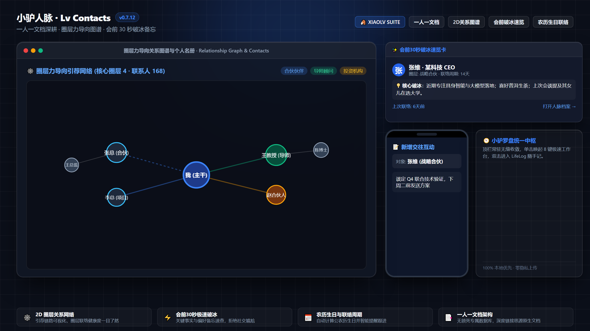

# Lv Contacts (小驴人脉)

**Manage people and relationships in SiYuan: person records are documents backed by a native SiYuan database.**

**Latest stable release: v0.6.0** · [Download and install](https://github.com/ai68298100/siyuan-contacts/releases/tag/v0.6.0) · [Open an issue](https://github.com/ai68298100/siyuan-contacts/issues)

English | [简体中文](README.md)

---

Lv Contacts keeps people, relationships and shared experiences in your SiYuan workspace. Each person is a regular SiYuan document; structured profile fields live in a native database bound to that document, alongside SiYuan search, backlinks and sync.

## This release: v0.6.0 Milestone (2026-10-27)

Lv Contacts officially steps into the 6.0 milestone era, delivering ecosystem federation v2, bilateral flashcard integration, and rich personal relationship insights:

- **Ecosystem Super Federation Bridge v2**: Added `appendFact` and `getFacts` capabilities to `window.LvContacts`. Seamlessly integrates with siyuan-glean for viewpoint clipping and siyuan-card for FSRS memory retention.
- **Instant Social Knowledge Flashcards**: One-click generation of Q&A flashcards for vital preferences, dietary restrictions, and milestones directly from fact cards.
- **Full v0.6.0 Capability Suite**: Includes interactive edge filtering, 320px quick drawer, incremental city rebase, 5 theme schemes, full-fidelity vCard, potential connections discovery, and review doc generation.

Validation: `pnpm check` (0 errors / 0 warnings), all unit tests passing; production build and release checks passed.

## Previous release: v0.5.99 (2026-10-27)

This release implements the Review Document Generator for native SiYuan workspace knowledge consolidation:

- **Review Document Generation (Review Doc Generator)**: One-click export of periodic relationship reviews into native SiYuan documents (`custom-lvct-review`), consolidating interaction stats, top contacts with bilateral `siyuan://blocks/` links, and full interaction timelines.
- **Direct Editor Navigation**: Added instant document generation button in `ReviewReportDialog` with direct "Open in Main Editor ↗" feedback.

Validation: `pnpm check` (0 errors / 0 warnings), all unit tests passing; production build and release checks passed.

## Previous release: v0.5.98 (2026-10-27)

This release implements the Potential Connection Discovery engine and one-click bilateral relationship establishment:

- **Potential Connection Discovery (connections-discovery.ts)**: Automatically detects candidates with frequent co-attendances and shared organization affiliations who lack explicit related links, computing explainable tie-strength scores.
- **Bento Dashboard Discovery Modal**: Added action tool button and dedicated modal to inspect potential ties and establish bilateral links in seconds.

Validation: `pnpm check` (0 errors / 0 warnings), all unit tests passing; production build and release checks passed.

## Previous release: v0.5.97 (2026-10-27)

This release implements full-fidelity vCard 3.0 / RFC 6350 export and import with native mobile contacts integration:

- **Full-Fidelity vCard Interoperability**: Support serialization and round-trip parsing for WeChat (`X-WECHAT`), city addresses (`ADR;TYPE=HOME`), organizations (`ORG`), and job titles (`TITLE`).
- **Native Smartphone Contacts Compatibility**: Exported `.vcf` files display city, WeChat, and job titles directly in Apple iOS Contacts, Huawei, and Xiaomi address books.

Validation: `pnpm check` (0 errors / 0 warnings), all unit tests passing; production build and release checks passed.

## Previous release: v0.5.96 (2026-10-27)

This release implements a theme color switcher with 5 refined palettes and live design-token synchronization:

- **Theme Color Schemes**: Choose among 🧡 Cognac Orange (default), 💚 Emerald Jade, 💙 Deep Ocean Blue, 💜 Royal Amethyst, and 💛 Amber Gold.
- **Live Theme Palette**: Instant theme preview in the settings general tab, driven by `[data-lvct-theme]` token overrides for complete border, glow, and shadow consistency across sessions.

Validation: `pnpm check` (0 errors / 0 warnings), all unit tests passing; production build and release checks passed.

## Previous release: v0.5.95 (2026-10-27)

This release implements controlled document sections for Quotes & Facts and live projections in the Quick Drawer:

- **Quotes & Facts Controlled Section**: Added `custom-lvct-facts` block support in person documents across 4 categories (💡 quotes, ❤️ preferences/diet, 💼 backgrounds, 📌 key facts) with lossless round-trip Markdown serialization.
- **Bi-Directional Inspection**: Added interactive facts card in PersonDetail and synchronized key facts projection in the graph Node Quick Drawer.

Validation: `pnpm check` (0 errors / 0 warnings), all unit tests passing; production build and release checks passed.

## Previous release: v0.5.94 (2026-10-27)

This release closes GitHub Issue #135 directive requirements and consolidates design token scales:

- **Ecosystem Fleet Directive Closure**: Formally verified all 8 requirements from Issue #135 (brand keywords, dedicated settings window, event names, checkin bridge, Raikiri widget, monochrome vector icon, SQL guards, and visualViewport handling) and closed the issue.
- **Deep Design Token Consolidation**: Replaced discrete hex literals across avatars, switches, badges, and shadows with `_tokens.scss` variables and dynamic `color-mix` formulas for seamless dark and high-contrast theme compatibility.

Validation: `pnpm check` (0 errors / 0 warnings), 918 unit tests (100% pass rate); production build and release checks passed.

## Previous release: v0.5.93 (2026-10-27)

This release implements the Node Quick Drawer in the relationship graph for seamless profile inspection:

- **Graph Node Quick Drawer**: Click any person or organization node on the canvas to slide out a 320px quick drawer, showing avatar, group, city, affiliation, and graph degree without interrupting the topology flow.
- **One-Click Communication Copying**: Phone, WeChat, and email entries support fast clipboard copying with emerald-green checkmark feedback.
- **Quick Action Bar**: Direct buttons for "Full Profile ↗" and "Open Doc ↗", supporting Escape key and blank-canvas tap to dismiss smoothly.

Validation: `pnpm check` (0 errors / 0 warnings), 918 unit tests (100% pass rate); production build and release checks passed.

## Previous release: v0.5.92 (2026-10-27)

This release implements automatic incremental controlled updates for city topic documents and consolidates city organization extraction:

- **City Topic Incremental Auto-Rebase**: Automatically detects residence city deltas in the background and safely updates the `custom-lvct-city-contacts` controlled section in existing city topic documents without overwriting personal travel notes and restaurant itineraries.
- **Unified Organization Extraction**: Extracted multi-source organization clues (work, education, affiliations) into pure function `extractCityOrganizations`.

Validation: `pnpm check` (0 errors / 0 warnings), 918 unit tests (100% pass rate); production build and release checks passed.

## Previous release: v0.5.91 (2026-10-27)

This release implements interactive edge legend filtering in the relationship graph and refactors the test runner infrastructure:

- **Interactive Graph Edge Legend & Filtering**: Added dedicated edge legends for Direct Relations (solid), Org Memberships (dashed), Co-Occurrences (dotted), and Doc References (ref dotted). Click any edge legend to filter or restore edges in Cytoscape and text views instantly.
- **Dynamic Glob Test Suite**: Modernized package.json test script with glob pattern matching, reinforced by architecture boundary tests.
- **Dependency Upgrades**: Upgraded @lucide/svelte (^1.61.0), vite (^8.3.5), sass (^1.106.1), and svelte-check (^4.7.7).

Validation: `pnpm check` (0 errors / 0 warnings), 916 unit tests (100% pass rate); production build and release checks passed.

## Previous release: v0.5.90 (2026-10-27)

This release implements the core stage of the 2026-2027 Roadmap, lowering database configuration thresholds and polishing design micro-textures:

- **Database Field Mapping "✨ Smart Match Columns"**: One-click semantic detection across existing SiYuan attribute view columns (Phone, WeChat, Birthday, Group, Tags), mapping field IDs in seconds.
- **Database Health Micro-Embossing**: Self-governed card styling with soft borders, inner highlights, and semantic status tinting.
- **Tri-Entity Doc Strip**: Live floating action banner in SiYuan main editor for Persons (warm cognac), Organizations (sky cyan), and Cities (amber gold) with instant interaction recording.
- **Bilateral Daily Note & City Doc Sync**: Multi-participant events append bi-directional block links to Daily Notes automatically; city documents maintain controlled contacts blocks without overwriting personal travel notes and restaurant itineraries.
- **Lv Ecosystem Federation Ready**: Full bridge support with siyuan-checkin, siyuan-speed-switch (Raikiri), and `window.LvContacts`.

Validation: `pnpm check` (0 errors / 0 warnings), 915 unit tests (100% pass rate), 488/488 automated UI tests across desktop, mobile, and host styles; production build and release checks passed.

## Previous release: v0.5.18 (2026-10-18)

This patch closes the contact-picker and organization-affiliation workflow gaps.

- Fixed the real-click outside-click race that immediately closed the “Choose contact” empty-state picker; added trusted click, Enter, Escape, outside-close, and focus-return coverage.
- Unified work, school, and other affiliations into a searchable multi-select with independent category, current/history, department, title, dates, status, and notes.
- Added a real create-organization path that selects the returned stable document ID; drafts, partial success, and unknown results remain recoverable.
- Consolidated search, filtering, batch selection, and form-save boundaries, including multiple historical periods for one organization and missing candidates.

Validation: local `pnpm check` (0 errors / 0 warnings), 728 unit tests, Chrome UI 473/473, and the main-branch GitHub Actions CI pass. Daily user workspaces and Android devices remain separate acceptance steps.

## Previous release: v0.5.17 (2026-10-17)

This patch completes the #51/#54 repeated-fields and personal-note workflow.

- Person details support repeated phone, WeChat, email, and other entries, two-level groups, regrouping, ungrouping, ordering, deletion, clearing, and recreation with stable entry identity and full values.
- Read-only details support local filtering and full-content copying; entering edit mode after filtering still saves the complete snapshot.
- Personal-note conflicts can be reread with an explicit keep/discard draft choice; legacy notes split by blank lines can be reviewed, safely detached, and manually restored without overwriting the original text.
- Reopen, same-name isolation, and two-page conflict behavior were verified against an isolated SiYuan Kernel and Chrome.

Validation: `pnpm check`, 710 unit tests, desktop/390px/host-style UI 416/416, and E2E safety and Kernel smoke 17/17 pass.
Issue #35 still awaits a redacted Xiaomi VCF; the candidate vCard fix is not claimed as a confirmed root-cause fix.

## Previous release: v0.5.14 (2026-10-16)

This patch fixes vCard imports stopping at a nameless card.

- Cards with both `FN` and `N` empty are skipped individually so later named cards can still be imported.
- A file with no valid named cards still fails clearly and creates no empty contacts.
- Issue #35 still lacks the original Xiaomi VCF, so the candidate format root cause remains unconfirmed.

Validation: `pnpm check`, 596 unit tests, and desktop/mobile UI 378/378 pass.

## What's new in v0.5.12

Improved vCard import fallback for blank `FN` values and added strict-import regression coverage for BOM and structured `N` names.

## What's new in v0.5.10

This patch release resolves vertical text compression in the stale-contacts dashboard and streamlines form wording and option hierarchies across creation, editing, and organization workflows.

Fixed: stale contacts layout and text compression

- Eliminated vertical single-character text squeezing caused by unconfigured profile fields in narrow flex containers; compact profile summaries now enforce single-line layout and smooth truncation.
- Redesigned stale-contacts and upcoming-birthdays lists into modern two-tier card rows with 32px Squircle soft-gradient avatars mapped to five relationship groups.

Improved: creation, edit, and organization form options

- Upgraded primary save and creation buttons from text-only links to solid buttons with 1px top highlights and tactile micro-press feedback.
- Refined form hint copy, removing internal implementation jargon in favor of natural product descriptions.
- Reordered organization affiliation categories to match real-world frequency (Work, Education, Family, Other).

Validation: `pnpm check` (0 errors / 0 warnings), 594 unit tests (100% pass), desktop/mobile UI regression 378/378 each, and release gates pass.

## What's new in v0.5.9

This release delivers an extensive modern design overhaul, restoring visual depth, typography hierarchy, micro-interactions, and refined physical feel across both desktop and mobile viewports.

Added: modern design system and layered depth

- Introduced Ambient Occlusion multi-layer soft shadows and 1px inner rim highlights, resolving pale card washout and harsh dark wireframe aesthetics.
- Upgraded avatars, person details, wizard logos, and organization badges to smooth Squircle geometry with 135° dual-color gradients across five contact groups.
- Dashboard stats now feature a radial ambient glow and 28px tabular-nums typography.

Added: segmented sliding controls and frosted glass panels

- Rebuilt card/table view toggles as iOS/Linear-grade inset sliding tracks with active floating pill indicators and micro-haptic press feedback.
- Upgraded dialog backdrops with modern 10px frosted blur (`backdrop-filter: blur(10px)`) and a bold 22px / 700 header layout.
- Graph controls now float as a frosted capsule island (`blur(16px)`), complemented by a central radial light field.
- Organization cards feature 40px Squircle badge boxes and active member status breathing dots (Status Dot).

Improved: sidebar, table view, timeline and details

- Sidebar navigation items adopt modern floating pill selection and glowing brand iconography.
- Contacts table introduces sticky frosted headers (`backdrop-filter: blur(8px)`) and active row accent highlights.
- Person detail interaction history is restructured into a connected timeline track with stepped cards and dual-color exchange ledger badges.
- Upgraded settings navigation, tactile iOS 18-grade switches, 18px Squircle welcome wizard, 6px slim frosted scrollbars, and mobile bottom bar blur.

Validation: `pnpm check` (0 errors / 0 warnings), 594 unit tests (100% pass), desktop/mobile UI regression 378/378 each, and production release gates all pass.

## What's new in v0.5.8

This patch release fixes large imports, contact view switching and organization management, and adds batch organization membership actions.

Added: batch add contacts to an organization

- Select multiple contacts and register them in one organization. The selected scope is frozen, archived organizations are disabled, and empty states offer a create-organization route.
- Loading and saving lock duplicate actions, closing and scope changes.

Improved: batch feedback

- Partial failures show the affected contacts and readable errors; retry only sends failed contacts and never repeats successful writes.
- Successful writes refresh the roster and expose a clear result.

Fixed: large imports, view flicker and organization layout

- Attribute-view binding and document mapping use verified batches of 50, preventing 400+ imports from stopping after the first 50 contacts.
- Card/table switching keeps the local view intent, avoids skeleton flicker and restores detail focus after refresh.
- Organization member controls no longer collapse; desktop dialogs use a wider workspace while mobile remains full screen.

Validation: `pnpm check`, 594 unit tests, desktop/mobile UI regression 378/378 each, `pnpm build` and `pnpm check:release` pass.

## What's new in v0.5.7

### Design tokens and component consistency

- Added a three-layer Primitive → Semantic → Component token system for color, spacing, typography, radii, shadows, z-index, motion and control sizes. Light and dark themes now share the same semantic contract.
- Unified button, field, checkbox, radio, loading and focus-ring variants so new screens can reuse the same components.

### Measured consolidation

- Token coverage: 38.86% → 41.19%; color literals: 202 → 196; length literals: 2,057 → 1,936; non-4px-grid lengths: 1,159 → 1,071; font-size variants: 29 → 28.
- Reproduce the audit with pnpm audit:tokens; see [token consolidation report](docs/TOKEN-CONSOLIDATION-2026-10-14.md).

This release completes isolated-kernel and real browser-desktop acceptance, fixes the authentication cleanup boundary, and continues the contact and organization workflow refinements.

Added: isolated-kernel real frontend acceptance

- Added evidence for real browser-desktop dual-page, organization member/archive, birthday, ledger, alias, follow-up and cross-window flows.
- All writes, restart reads, migration checks and release artifacts use an isolated workspace.

Improved: E2E authentication and cleanup

- Injects the isolated kernel `api.token` before first-page and second-page navigation to avoid anonymous requests triggering the kernel failed-authentication limiter.
- Temporary notebooks are reliably cleaned after the real frontend run.

Fixed: E2E authentication race

- Fixed missing `Authorization` headers with kernels that store the token under `conf.api.token`.
- Fixed the second isolated page navigating before authentication headers were installed.

Added: contact creation prerequisites

- When relationship labels are entered, a new contact can create or select the self profile first. Failed prerequisites keep the current draft and do not leave a partial contact.

Improved: self profile editing and async states

- The self profile editor now exposes work and school organization choices, hides the inapplicable self relationship field, and keeps a stable loading state.
- Busy actions in import, batch operations and profile editing are disabled consistently to prevent duplicate submissions.

Fixed: related-person reads and self entry points

- Empty relation cells that omit `relation` or `blockIDs` are treated as empty; malformed non-empty relation data still stops writes for verification.
- Self markers are consistent across roster, search and detail entry points, so organization memberships can be edited from every route.

## 🐴 Little Donkey plugin series

Currently developed plugins:

- [**小驴雷切**](https://github.com/ai68298100/siyuan-speed-switch)
- [**小驴打卡**](https://github.com/ai68298100/siyuan-checkin)
- **小驴人脉** (this project)
- [**小驴拾遗**](https://github.com/ai68298100/siyuan-glean)

Each plugin is maintained independently and can be used on its own or alongside the others.

## Features

| Area | What it does |
|---|---|
| Contact roster | Card and table views, search, groups, combined filters, saved views, profile completion, batch adoption of existing notes and suspected-duplicate hints |
| Contact import and entry | Import vCard 2.1/3.0/4.0 files and export vCard 3.0; recognize pasted business-card or chat text, selected editor text or a whole note |
| Person profiles | Self profile, aliases, relationship labels relative to you, a profile strip in person documents and a free-form note written back to each person document |
| Relationships and organizations | Two-way person relations, relationship and document-reference graphs, organizations, membership history, common background and graph queries |
| Interactions | Capture attendees from meeting notes; interaction timeline, reusable note templates, exchange ledger, review reports and meeting briefings |
| Reminders and follow-ups | Solar and lunar birthdays, contact cadence and inactivity reminders; follow-ups can sync with native SiYuan task blocks in person documents |
| Health and integrations | Read-only data health checks with jump-to actions; window.LvContacts lets other plugins search/create people and record shared experiences |
| Mobile layouts | Responsive workspace and fullscreen dialogs, covered by isolated mobile-viewport regression tests |

## Install

Manual installation from GitHub Releases is currently recommended. The Marketplace submission has been merged, but availability in the client has not been verified on a real device.

1. Download `package.zip` from the [latest stable Release](https://github.com/ai68298100/siyuan-contacts/releases/latest).
2. Extract its contents into data/plugins/siyuan-contacts/ in your SiYuan workspace. plugin.json must be at that directory root.
3. Restart SiYuan and enable **Lv Contacts** under **Settings → Marketplace → Installed**.

Requires **SiYuan 3.8.5 or later**.

## Data and privacy

Person documents, per-person notes and the contact database are SiYuan workspace content. The plugin sends no telemetry. AI recognition runs only after an explicit user action and sends the relevant note content to the AI service configured in SiYuan.

Plugin-managed data includes interactions, follow-ups, cadence and reminder state, adoption dates, templates, exchanges, aliases, self identity, organization memberships, organization profiles and relationship labels. It is stored in SiYuan's plugin data directory and may be lost when that data is deleted. Export the plugin data migration bundle from **Settings → Export Center** before uninstalling or deleting plugin data.

The migration bundle is a JSON value snapshot with a preview and merge flow, not a workspace or byte-for-byte backup. It covers those 12 plugin-data modules, but excludes person and organization documents, the contact database, database anchors, UI preferences and unfinished operation checkpoints. A per-person note lives in its person document and is not exported as a separate bundle entry. To move to another workspace, migrate the SiYuan documents and database first, rebind the database in the plugin, then import the bundle. The plugin does not guess document identity by matching names.

## Known limitations

- Isolated viewport and kernel tests do not establish acceptance in a real host. A real user workspace, Android device, keyboard/safe-area behavior and actual multi-window use have not been verified.
- Opening SiYuan's native graph, task-manager interoperability and Marketplace availability have not been verified; use the manual installation steps above.
- The in-app English translation is incomplete, so some interface text may appear in Chinese.
- CardDAV address-book sync and CalDAV calendar sync are not supported. Contacts can be exchanged using vCard files.

See the [v0.5.14 release notes](docs/RELEASE-NOTES-v0.5.14.md) for validation scope; previous release notes remain available for v0.5.13, v0.5.12, v0.5.11, v0.5.10, v0.5.9 and v0.5.8.

## Quick start

1. Click the Lv Contacts toolbar icon and follow the wizard to create the contacts notebook and database.
2. Create a person, adopt existing notes, import a .vcf, or paste text to recognize profile details.
3. Add relationships, organization memberships, a per-person note or exchange records in the person detail.
4. In a meeting note, right-click and choose **Lv Contacts: capture people from this note** to record attendees and a shared occasion.
5. Review birthdays, contact reminders and follow-ups from the home view. Export the plugin data migration bundle before uninstalling.

## Development

Requires Node.js 24 or later and pnpm 12.x. Install dependencies and start SiYuan. Before the first hot-reload session, run pnpm make-link, then run pnpm dev.

Common checks: pnpm check, pnpm test, pnpm test:ui, pnpm test:ui:mobile, pnpm build and pnpm check:release. Mobile viewport tests do not replace real-device acceptance.

See [AGENTS.md](AGENTS.md) and the [handoff guide](docs/HANDOFF.md) for development conventions, the [data contract](docs/DATA-CONTRACT.md) for storage boundaries, and the [changelog](docs/CHANGELOG.md) for changes.

## Feedback and license

Report issues and request features in [GitHub Issues](https://github.com/ai68298100/siyuan-contacts/issues), including SiYuan/plugin versions, reproduction steps and redacted logs.

QQ group: **871707735**

[MIT License](LICENSE)
