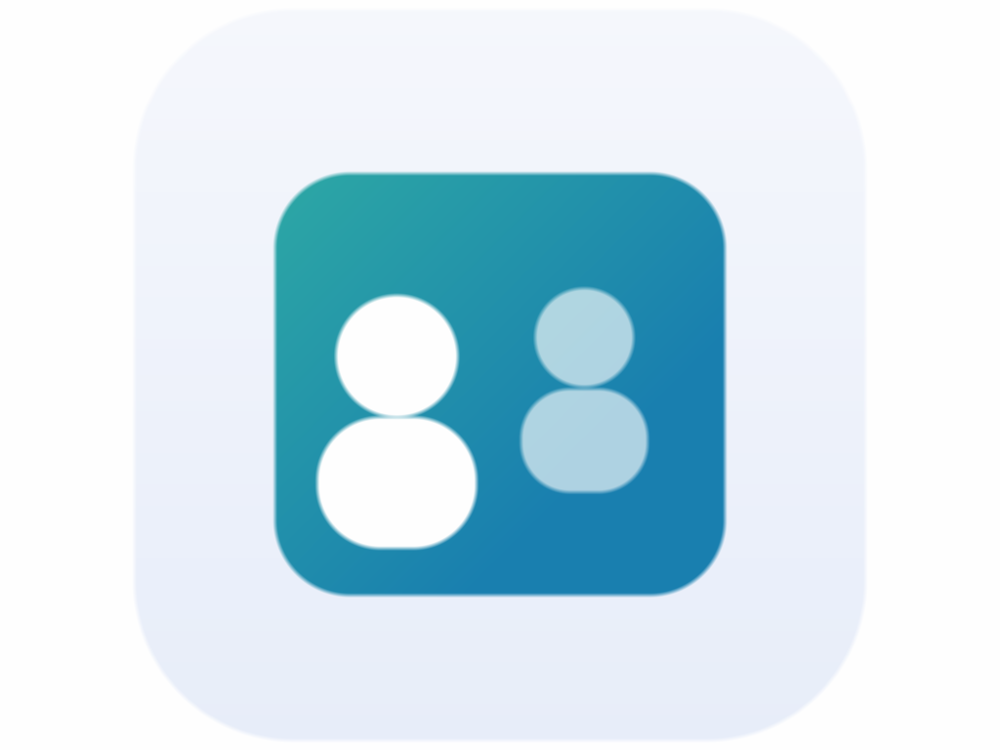

# 小驴人脉 · Lv Contacts

**在思源笔记中管理联系人、人际关系、组织归属与重要日期**

一人一文档 · 原生属性视图 · 圈层联络周期 · 会前30秒破冰备忘 · 关系引荐图谱

**当前版本：v0.7.10** ｜ [English Documentation](README.en-US.md) ｜ [更新日志](CHANGELOG.md)

[⬇️ 下载安装](#-安装方式) · [🚀 快速上手](#-三步快速上手) · [🖥️ 面板指南](#-工作台与各主要面板用途) · [⚙️ 设置参考](#-设置项参考说明) · [⌨️ 快捷键](#-快捷键一览) · [🔒 隐私与迁移](#-数据与隐私声明)

 

---

## 🎯 为什么需要小驴人脉？它解决什么问题？

在日常工作与生活中，人脉资料往往散落在手机通讯录、微信备注与零散笔记里：**见过面却忘了上次聊过什么、谁引荐认识的、对方有什么饮食忌口，或者重要朋友在忙碌中不知不觉疏远冷却。**

| 痛点场景 | 传统通讯录 / 销售 CRM 局限 | 小驴人脉解决方案 |
| :--- | :--- | :--- |
| **笔记与资料割裂** | 商业 CRM 与笔记笔记脱离，记录一段会面谈话需要到处复制粘贴 | **一人一文档**：每位联系人既是独立的思源笔记文档，又是数据库中的结构化实体，双链自然网状生长 |
| **联络疏远与关系降温** | 微信好友成百上千，不常联系的朋友不知不觉断联数年 | **圈层联络周期（Cadence）**：划分核心圈(14天)/熟人圈(30天)/合作圈(90天)/常青圈(180天)，超时主动提醒问候 |
| **临时赴约大脑空白** | 临时聚会、出差拜访前翻不到背景资料，想不起初识场合与共同熟人 | **会前 30 秒破冰卡**：一屏聚合初识来源、引荐人、喜好忌口雷区、往来承诺及共同熟人，赴约从容有底 |
| **关系网复杂看不清** | 谁是谁的校友、谁引荐了谁、多段公司任职变动难以直观梳理 | **双模式交互图谱**：Cytoscape 动态网络图谱，直观呈现引荐链路、共同出席圈子与跨组织人脉桥梁 |

---

## 🌟 核心功能全景

- **👤 一人一文档（Doc-as-Person）**：无缝打通思源原生属性视图（Attribute View），支持多标签、联系方式分组、公农双历生日提醒与一键打开原生思源文档深度书写。
- **⏱️ 圈层周期与温度雷达**：按核心圈、熟人圈、合作圈设置联络频次，基于最后互动日志动态计算疏远度，名册支持「⌛ 待问候」胶囊秒级过滤。
- **☕ 会前 30 秒破冰备忘卡**：聚会与会面前一键查看关键备忘——包含初识时间地点、引荐人指针、过敏忌口、个人偏好、未履行的承诺（Promises）与往来账本。
- **🕸️ 交互式人际与组织图谱**：基于 Cytoscape.js 打造的高性能关系图谱，支持引荐网络、家庭称谓、社团组织层级与思源文档双向引用网多维切换。
- **📱 移动端与全屏触控优化**：专为手机端优化的 100vw/100dvh 全屏工作台，支持手势下拉退出、输入法键盘智能避让与打开文档后自动收起工作台。Android 软键盘/系统返回与 CardDAV 双向同步仍在真机验收中，详见 `docs/CURRENT-STATUS.md`。
- **🔄 全要素无损导入导出**：支持标准 vCard 3.0/4.0 通讯录双向互通、CSV 批量导入导出，以及 24 模块全要素数据迁移包（无损往返，现状优先合并）。

---

## 🖥️ 工作台与各主要面板用途

| 面板 / 视图 | 唤起方式 | 核心定位与业务场景 |
| :--- | :---: | :--- |
| **名册总览 (Contacts Hub)** | 顶栏图标 / `Alt+Shift+O` | 联系人列表与卡片流：支持快速搜索、圈层过滤、待问候筛选、批量标签与多选操作。 |
| **人物详情 (Person Detail)** | 点击联系人卡片 | 360° 个人档案：基本信息、联络方式、互动日志、备忘闪念、组织任职与会前 30 秒卡片。 |
| **关系图谱 (Network Graph)** | 工作台图谱入口 | 可视化人脉脉络：探索引荐链、社交圈层聚集、共同熟人交集与跨组织桥梁人。 |
| **跟进日程 (Cadence Hub)** | 筛选「⌛ 待问候」 | 关系温度维护中心：查看各圈层已逾期或即将逾期的联系人，点击一键记录会面或问候。 |
| **导入导出中心 (Migration)** | 设置面板入口 | 通讯录同步枢纽：vCard 导入导出、CSV 数据清洗导入、24 模块完整数据包备份与合并。 |

---

## 🚀 三步快速上手

1. **第一步：建立或导入你的第一批联系人**
   点击顶栏小马图标（或按快捷键 `Alt+Shift+O`）打开小驴人脉工作台。点击右上角「＋ 新建联系人」，录入姓名、组织与圈层档位；或者在设置中点击「导入 vCard」，一键将手机通讯录导入。
2. **第二步：记录一次互动或设定关系**
   在联系人详情页，点击「＋ 记录互动」，选择互动类型（聚餐/电话/线上交流），输入沟通要点并保存，系统将即刻刷新该联系人的最后互动时间与关系温度。
3. **第三步：会前速览与日常维护**
   拜访或聚会前，在名册中点击该联系人的「会前 30 秒卡」，快速扫读忌口与过往事项；每周点击「⌛ 待问候」筛选，查看有哪些值得关心的朋友已到联络周期。

---

## 📦 安装方式

1. **思源集市安装（推荐）**：打开思源笔记 `设置` → `集市` → `插件`，搜索 **「小驴人脉」**（或 `siyuan-contacts`），点击安装并启用；
2. **GitHub Release 手动安装**：从 [最新稳定版 Release](https://github.com/xiaolv-suite/siyuan-contacts/releases/latest) 下载 `package.zip`，解压至思源工作空间目录：`data/plugins/siyuan-contacts/`；
3. 重启思源笔记，在“设置 → 集市 → 已安装”中确认启用即可。

> 宿主要求：思源笔记 **v3.8.5 或更高版本**（全面兼容桌面端与移动端）。

---

## ⚙️ 设置项参考说明

| 分类 | 设置项名称 | 配置键 | 默认值 | 推荐与影响说明 |
| :--- | :--- | :--- | :---: | :--- |
| **文档与归属** | 联系人存放笔记本 | `settings.notebookId` | `默认工作笔记本` | 决定新建联系人思源文档时的默认存放笔记本 |
| **文档与归属** | 联系人文档前缀路径 | `settings.storagePath` | `/人脉/` | 联系人笔记的目录层级，便于在思源左侧树状大纲中保持整洁 |
| **联络周期** | 核心圈联络周期 | `settings.cadenceCore` | `14 天` | 关系最紧密的亲友/合伙人，超过 14 天未互动时标记为待问候 |
| **联络周期** | 熟人圈联络周期 | `settings.cadenceClose` | `30 天` | 经常往来的朋友或重要业务伙伴，默认月度联络 |
| **联络周期** | 合作圈联络周期 | `settings.cadencePartner` | `90 天` | 季度保持触达的合作方与行业人脉 |
| **联络周期** | 常青圈联络周期 | `settings.cadenceEvergreen` | `180 天` | 半年触达一次的长线人际连接 |
| **界面与交互** | 默认展示视图 | `settings.defaultViewMode` | `grid` | `grid`（名片网格）或 `table`（密集表格），大屏幕推荐表格 |

---

## ⌨️ 快捷键一览

| 快捷键 | 功能描述 | 适用上下文 |
| :--- | :--- | :--- |
| `Alt + Shift + O` | 快速唤出 / 关闭小驴人脉工作台 | 思源全局任意界面 |
| `/` 或 `Ctrl + F` | 快速聚焦名册搜索框 | 人脉工作台内 |
| `↑` / `↓` | 在联系人列表中移动选中项 | 人脉工作台列表 |
| `Enter` | 打开当前选中联系人的详情或思源文档 | 人脉工作台列表 |
| `Esc` | 关闭当前弹窗、抽屉或退出搜索聚焦 | 全局浮层 |

---

## 🔒 数据与隐私声明

- **本地存储位置**：
  - 联系人思源笔记文档保存在用户选择的思源笔记本内，享受思源原生端到端加密与同步；
  - 互动、联络节奏、关系称谓、模板等自管元数据保存在工作空间目录：
    `data/storage/petal/siyuan-contacts/`（纯本地 JSON 存储，零云端依赖）。
- **零遥测与隐私安全**：插件绝不采集任何通讯录隐私、绝不上报任何行为统计。AI 识别等高级能力只在用户主动触发时调用思源本体已配置的 AI 接口。
- **随时可迁移**：前往「设置 → 导出中心」，可随时一键导出包含 24 模块的完整数据迁移包（`.zip`），支持无损往返备份与跨设备恢复。

---

## ❓ 常见问题与故障排查 (FAQ)

- **Q1：更换新电脑或重装后，如何完整迁移人脉数据？**  
  **答：** 在更换设备前，请前往「设置 → 数据与字段 → 导出中心」，点击「导出插件完整迁移包 (.zip)」。在新电脑上点击「导入迁移包」，即可实现 24 模块全要素等价往返与现状优先安全合并。
- **Q2：公历生日与农历生日如何自动提醒？**  
  **答：** 编辑联系人时输入生日并勾选「农历」，插件内置百年农历算法引擎，每年会自动计算出对应的公历日期并显示倒数天数，无需手动每年换算。
- **Q3：手机端打开联系人文档后，人脉页面会挡在前面吗？**  
  **答：** 不会。从 v0.7.9 开始，在手机端点击打开联系人文案后，全屏工作台会自动优雅退场收起，底层文档即刻呈现，告别“以为没打开”的困惑。
- **Q4：导入外部通讯录 CSV 出现乱码怎么办？**  
  **答：** 插件已内置 UTF-8 与 GBK 智能编码探测器。如果从 Windows Outlook 导出的 CSV 文件含非标准编码，导入时选择「GBK / Windows 格式」即可正常解析。

---

## 🐴 小驴系列插件家族

小驴系列插件各自独立，可按需安装和组合使用：

| 插件名称 | 一句话简介 | GitHub 仓库 |
| :--- | :--- | :--- |
| [小驴雷切](https://github.com/xiaolv-suite/siyuan-speed-switch) | 思源中的统一导航与工作上下文平台，连接页签、工作台、片段和快捷入口。 | [xiaolv-suite/siyuan-speed-switch](https://github.com/xiaolv-suite/siyuan-speed-switch) |
| [小驴打卡](https://github.com/xiaolv-suite/siyuan-checkin) | 本地优先的习惯、目标打卡与复盘工作台。 | [xiaolv-suite/siyuan-checkin](https://github.com/xiaolv-suite/siyuan-checkin) |
| [小驴人脉](https://github.com/xiaolv-suite/siyuan-contacts) | 在思源中管理联系人、人际关系、组织归属和重要日期。 | [xiaolv-suite/siyuan-contacts](https://github.com/xiaolv-suite/siyuan-contacts) |
| [小驴拾遗](https://github.com/xiaolv-suite/siyuan-glean) | 整理思源剪藏和导入文章，支持状态分拣、阅读管理与日后回顾。 | [xiaolv-suite/siyuan-glean](https://github.com/xiaolv-suite/siyuan-glean) |
| [小驴考试（内测版）](https://github.com/xiaolv-suite/siyuan-exam) | 本地题库备考工作台，支持多格式导入、刷题、模考、错题复盘与 AI 辅助。 | [xiaolv-suite/siyuan-exam](https://github.com/xiaolv-suite/siyuan-exam) |
| [小驴管家（内测版）](https://github.com/xiaolv-suite/siyuan-home) | 管理家庭与生活资料、成员档案、台账、到期提醒和事务跟进。 | [xiaolv-suite/siyuan-home](https://github.com/xiaolv-suite/siyuan-home) |
| [小驴闪卡（内测版）](https://github.com/xiaolv-suite/siyuan-lv-cards) | 思源中的知识捕获、制卡、练习与复习平台，使用内核原生 FSRS 排期。 | [xiaolv-suite/siyuan-lv-cards](https://github.com/xiaolv-suite/siyuan-lv-cards) |
| [小驴常用（内测版）](https://github.com/xiaolv-suite/xiaolv-common) | 基于思源块保存、搜索并快速调用常用语、模板、代码和链接，支持变量填充。 | [xiaolv-suite/xiaolv-common](https://github.com/xiaolv-suite/xiaolv-common) |

交流 QQ 群：**871707735**（可反馈 Bug、提交需求和交流使用体验）。

---

## 📝 最近更新动态

- **思源 3.8.10+ 原生特性适配**：联系人详情头像支持右键唤出原生文件选择器（`openNativeAssetPicker`）；全域头像 URL 解析加固（支持相对资产路径与 DataURL）；图谱抽屉与组织文档支持原生文档树菜单；半角斜杠标题防截断。
- **输入法合成期全域守卫**：双端搜索框、人物速选器、别名、关系称谓、随手记、组织重命名、详情页七类输入等 16 处输入全面增加 IME 合成期守卫，Enter 选字不再误触发提交或弹出新建。
- **无障碍键盘可达闭环**：侧栏互动时间线条目、关系雷达节点、头像上传、组织卡片 4 处补齐 Enter/Space 键盘激活；关系图谱图例补齐 `aria-pressed` 状态播报。
- **移动端与视觉优化**：工作台底部留白对齐 64px 导航 + iOS 安全区（消除 20px 空白）；搜索框 16px 防缩放；名片 SVG 渐变 ID 增加主题后缀防碰撞。

展开查看历史版本更新（v0.7.9 及更早版本 · 完整记录见 <a href="./CHANGELOG.md">CHANGELOG.md</a>）

### v0.7.9（2026-11-10 · GitHub 组织迁移与体验加固）

- **仓库与提交身份迁移至 xiaolv-suite 组织**（plugin.json/文档/徽章全量对齐）；
- **移动端退场闭环**：全屏工作台内打开联系人原生文档后自动收起工作台（`openMobileFileById` 分流），告别“底层被遮挡”；
- **防误关多重守卫**：全屏手势下拉关闭加入输入框与软键盘豁免，打字中滑动光标不再意外关闭页面；
- **微胶囊反馈**：剪贴板复制动作统一支持即时触感与微胶囊提示；
- **顶栏罗盘升级**：启动收敛防抖、思源重启/同步后图标自愈守护与二级菜单长按防误触。

展开查看历史版本更新（v0.7.8 及更早版本 · 完整记录见 <a href="./CHANGELOG.md">CHANGELOG.md</a>）

### v0.7.8（2026-11-04）

- 全生态联合灾备总线（`lvBackup`）、全生态万物穿透搜索（`lvOmnisearch`）接入。

### v0.7.7（2026-11-02）

- 圈层联络周期档位（14/30/90/180天）、待问候筛选与 24 模块全要素数据迁移包。

---

## 📄 许可证 (License)

[MIT License](LICENSE) · Copyright (c) 2026 xiaolv-suite
