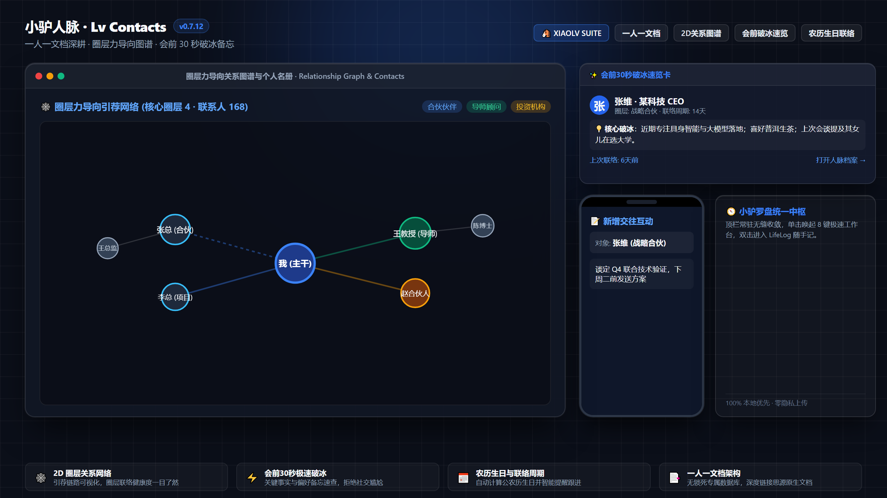

# 小驴人脉（Lv Contacts）

**在思源笔记中管理联系人、人际关系、组织归属与重要日期。**

**最新稳定版：v0.6.57** · [下载与安装](https://github.com/ai68298100/siyuan-contacts/releases/tag/v0.6.57) · [提交问题](https://github.com/ai68298100/siyuan-contacts/issues)

[English README](README.en-US.md)

---

小驴人脉把联系人、关系和共同经历放进思源工作空间。每个人对应一篇普通思源文档，结构化资料保存在关联的思源数据库中，可以继续使用思源的搜索、双链和同步能力。

---

## 💡 核心功能与主要作用全景

小驴人脉是一款**本地优先（Local-First）**、**注重隐私**且**深度融入思源笔记双链生态**的个人关系与人脉资产管理平台（Personal CRM / PRM）。与传统销售型 CRM 不同，小驴人脉聚焦于真诚人际关系的长期维系、温度追踪、互惠交往与记忆沉淀。

| 模块 | 核心作用与价值 | 关键能力特性 |
| :--- | :--- | :--- |
| **📇 全景人脉档案 （一人一文档）** | 每一位联系人对应一篇原生的思源笔记文档，结构化资料保存在关联数据库中，既是结构化名册，又是完整的人生笔记与交往主页。 | • 原生 Attribute View 属性视图主干 • 姓名、电话、微信、邮箱、网站、城市、生日（公历/农历智能换算） • 离席隐私保护盾（一键自动遮罩电话、微信、邮箱，支持 5 秒临时显形） • 姓名首字多彩 Squircle 头像色谱与拼音首字母快速索引 |
| **🌡️ 人脉温度与联系节奏 （Cadence & Health）** | 摆脱机械死板的提醒，基于客观交往时间推导关系温度，防止重要人脉在忙碌中不知不觉冷却疏远。 | • 四级关系温度动态推演：🔥 温热（近期常联系） / 🍃 常温（良好） / 🌬️ 微凉（轻度逾期） / ❄️ 渐冻（深度疏远） • 自定义独立联系节奏（1–365 天）或个性化暂停免打扰 • 首页仪表盘「🧊 关系降温预警与破冰重联中枢」，加权星标 VIP 与逾期天数，一键直达破冰画像 |
| **💬 交往互动与场景化模板 （Timeline & Templates）** | 告别干瘪简陋的备忘，以生动的对话气泡时间轴记录每一次交流、电话与聚会，随路提炼长期画像。 | • 拟物气泡式交往互动时间流，区分拜访、咖啡、用餐、电话、即时消息与会议 • 9 组精选高频场景化备注模板（商务拜访、咖啡小聚、餐饮宴请、活动论坛、请教咨询、日常问候等） • 动态变量插入器与上下文自动填充（`{{姓名}}`、`{{日期}}`、`{{上次互动}}`、`{{公司}}`、`{{职位}}`、`{{城市}}`） • 记互动随路智能提炼观点见解、喜好忌口与关键事实 |
| **🗓️ 会客拜访与行前准备 （Itineraries & Visits）** | 专门针对出门见客、商务出差与重要会谈设计，让每一次赴约前从容有据，会后无需重复录入。 | • 结构化拟定会面主题、时间、地点、随行人员与补充备忘 • 行前核验清单（资料/样品/合同/伴手礼）支持交互式打勾确认 • 待赴约倒计时动态标签（今天 / N天后 / 已逾期） • 会后一键「履约并记互动」自动填充纪要草稿并沉淀至时间轴；一键复制 Markdown 行程单 |
| **🛡️ 社交偏好与雷区排查 （Preferences & Taboos）** | 结构化管理朋友与客户的真实饮食喜好与敏感雷区，出门聚餐与商务招待永不踩坑。 | • 四维偏好自管：🍲 饮食偏好与忌口、☕ 茶酒咖啡饮品、🤝 会面交往习惯、🚫 敏感话题与雷区 • 详情页头部「常客喜好速览微标签绶带」，红线禁忌高光警示，1 秒洞悉人物饮食偏好 • 首页仪表盘「🛡️ 会前速查与偏好雷区大盘」，全库排查红线忌口与待履约信诺，一键直达画像 |
| **🌱 交往生命周期与漏斗 （Lifecycle Funnel）** | 契合人际交往从浅到深的自然演进规律，为个人关系提供宏观发展战略与梯队成熟度全景。 | • 五阶演进模型：🌱 初相识 ➔ 💬 常交流 ➔ 🚀 共合作 ➔ ⭐ 核心挚友 ➔ 💤 沉睡维护 • 记录阶段变迁日期与备忘历史；名册支持多选批量调整交往阶段 • 首页仪表盘「交往生命周期漏斗与转化看板」，计算深度合作与盟友率，点击各阶段一键直达名册筛选 |
| **⚖️ 交往互惠与双向平衡 （Reciprocity & Balance）** | 审视人际交往中的双向互利属性，避免单向索取或单向过度付出，维系长久健康的人脉网络。 | • 双向信诺对账：分别统计我方承诺与对方承诺各自履约兑现率 • 人情往来对账：应收付出 vs 应付受惠金额净差额透视 • 双向付出天平比例条直观审视对称性，推导 0–100 综合互惠指数并给出针对性维系建议 |
| **🌐 全景关系图谱与拓扑分析 （Network Graph & Hubs）** | 直观透视错综复杂的人际网络，发现圈层之间的连接纽带与关键引荐人。 | • 双图模式：显式人际关系图 + 思源原生文档双链引用图 • 4 大布局引擎：力导向聚类 (CoSE)、六度辐射圈 (Concentric)、层级展开 (Breadthfirst)、全局环形 (Circle) • 时间轴演化回放滑块，亲眼见证人脉网络从萌芽到繁茂的时序生长 • 「🌐 核心枢纽与跨界桥梁人」拓扑分析，挖掘超级连接者与跨圈引荐桥梁人，一键画布定位居中 |
| **📜 人脉编年史与实体沉淀 （Chronicles & Documents）** | 将岁月长河中的每一次交集、里程碑与重要时刻沉淀为可以一生回味的人生笔记。 | • 提取初相识、阶段跃迁、周年纪念、履约信诺与人情礼往，汇编为纵向发光轨道编年史长卷 • 一键沉淀为思源实体文档（`/人脉回顾/📜 人脉交往编年史 · 姓名`），一键复制全文 Markdown • 详情页顶部「相识相聚周年纪念里程碑提醒挂件」，满 N 周年高亮提醒，一键填入温情祝贺文案 • 全量与单人重要日期导出为标准 RFC 5545 iCalendar (`.ics`) 日历文件 |
| **🎴 视觉名片海报与常识闪卡 （SVG Cards & Flashcards）** | 为人脉引荐、社交分享与常识记忆提供高保真视觉与认知记忆武器。 | • 纯矢量 SVG 高保真名片（横版 600x380 / 立式海报 440x600，轻奢/极简/极夜三主题），一键复制 SVG 或下载名片 • 一键将人物观点、喜好、谈资汇编生成思源原生 Riff 问答闪卡实体文档，结合 FSRS 算法高效对抗遗忘 |
| **👥 组织机构网络与家庭亲属谱系 （Orgs & Kinships）** | 还原人脉所处的组织坐标与血缘亲情背景，理解人物背后的系统网络。 | • 组织档案与多段成员任职履历维护，支持多组织归属与历史变迁追踪 • 五大层级（长辈/配偶/同辈/晚辈/亲戚）温情家庭亲属关系树谱，已建档亲属一键穿透直达 |
| **🧹 名册高级筛选、治理与导出 （Filters, Tidy & Export）** | 赋能大规模人脉管理，告别杂乱无章，畅通无阻地在本地与主流办公软件间流转数据。 | • 关系温度、生命周期、常驻地域、工作单位、资料缺口多维交叉组合筛选，支持保存常用自定义视图 • 「待安顿整理抽屉」：智能挖掘缺分组/无标签联系人，结合履历关键词与现有分组推断推荐分组与画像标签 • 批量导出自带 UTF-8 BOM 的标准 CSV 表格（Excel / WPS 打开绝不乱码）；一键复制 Markdown 宽表花名册 • vCard 2.1/3.0/4.0 导入与 vCard 3.0 全要素高保真导出（与苹果 iOS / 安卓手机通讯录双向互通） |
| **🔒 本地优先与数据自主迁移 （Privacy & Local-First）** | 真正的数据自主权：零云端依赖、零数据外泄风险，完整的数据备份与迁移机制。 | • 数据 100% 存储于本地思源笔记工作空间，零遥测，零外部网络依赖 • 插件自管数据采用 Web Lock 排他锁保护与写后回读严格校验 • 提供带差异预览的完整插件数据迁移包（导出/预览/现状优先导入合并），换机迁移无忧 |

---

## 最新版本（v0.6.57 · 2026-10-29）

本版本重磅推出联系人名册「交往深度多维排序与交往密度热点排行」及首页仪表盘「相识相聚重要周年纪念日与里程碑大盘中枢」：

- **名册交往深度多维排序（`PeopleSortMode` & `PeopleView.svelte`）**：排序方式新增「按交往密度」（`frequency`）与「按最新录入」（`created`）；`loadRecentInteractions` 升级累计各人脉总互动次数 `count`；名册与卡片直观呈现互动频次标徽与关系温度；支持按交往频次降序快速发现核心挚友，按录入时间倒序追踪最新结识人脉。
- **首页近期周年纪念日与里程碑大盘（`AnniversariesHubDialog.svelte` & `DashboardView.svelte`）**：首页集成「近期纪念日」中枢；涵盖相识周年（🤝）、结婚纪念（💍）、入职合作（💼）与特别纪念（🎗️）；支持 90天/本月/本周/今日四维时序筛选与分类筛选；智能生成温润个性化祝贺寄语并支持一键复制；支持一键将全量周年纪念日批量导出为标准 RFC 5545 iCalendar（`.ics`）文件导入系统日历。

验证：本地 `pnpm check` 0 errors / 0 warnings，全量单元测试 1029/1029 100% 通过；三套浏览器 UI 回归全绿（527/527）；`pnpm build` 与 `pnpm check:release` 均通过。

---

<b>📜 历史版本更新记录（v0.6.56 ~ v0.5.2 点击展开）</b>

### v0.6.56 · 2026-10-29

重塑：联系人名册「待安顿联系人智能推荐与批量归纳整理抽屉」（Batch Tidy & Smart Categorization Drawer）

- **待安顿无序联系人挖掘与推断引擎（`domain/unorganized-tidy.ts`）**：纯函数识别全库缺少分组、无标签或常驻城市未知的人脉；结合人物组织职位经历与现有分组库，智能推断建议分组（`suggestedGroup`）与推荐画像标签（`suggestedTags`），生成结构化整理计划（`TidyPlanItem`）。
- **名册待安顿抽屉与一键采纳批量保存闭环（`TidyDrawer.svelte` & `PeopleView.svelte`）**：在名册操作区集成「待安顿整理」入口（带动态数量标徽）；抽屉清晰列出待安顿条目与推荐卡，支持单个点选采纳与「⚡ 一键采纳全部推荐」，一键批量落盘更新至 Attribute View 数据库单元格。

验证：本地 `pnpm check` 0 errors / 0 warnings，全量单元测试 1027/1027 100% 通过；三套浏览器 UI 回归全绿（526/526）；`pnpm build` 与 `pnpm check:release` 均通过。

### v0.6.55 · 2026-10-29

重塑：联系人名册「多维导出带有 BOM 的 CSV 与复制 Markdown 花名册宽表」（CSV Exporter & Markdown Table Generator）

- **标准 CSV 导出与 Markdown 宽表序列化**：`domain/csv-contacts.ts` 新增 `exportContactsToCsv` 与 `exportContactsToMarkdownTable`；遵循 RFC 4180 规范，字段包含逗号/换行时严格双引号转义；输出首字节自动附加 UTF-8 BOM（`\uFEFF`），彻底解决 Excel / WPS 打开中文花名册乱码痛点；提供排版规整的 Markdown 宽表生成。
- **名册批量栏双通道导出与即时反馈**：`PeopleView.svelte` 批量操作栏新增「导出 CSV」与「复制表格」按钮；点击「导出 CSV」即刻下载 `.csv` 表格文件，点击「复制表格」一键将花名册复制至剪贴板并呈现“已复制 ✓”绿色反馈，无缝满足本地数据流通与笔记协同。

验证：`pnpm check` 0/0、单测 1024/1024 绿灯、三套 E2E UI 回归各 525/525 全部通过、Release 门禁通过。

### v0.6.54 · 2026-10-29

重塑：联系人详情页「协作项目状态流转与进度指示」（Project Progression & Status Lifecycle Tracker）

- **项目状态机与协作者过滤算法**：`domain/projects.ts` 新增 `PROJECT_STATUS_METAS`、`getProjectStatusMeta`、`getNextProjectStatus` 与 `filterOtherCollaborators` 纯函数；规范进行中（`active` / 🚀）、已结项（`completed` / ✅）与已归档（`archived` / 📦）三态循环流转。
- **详情页项目卡片状态切换与联动**：`PersonDetail.svelte` 与 `Workbench.svelte` 完整接线 `onUpdateProject`；在项目条目中呈现状态胶囊按钮，支持一键点击流转状态并即时保存至 `person-projects.json`，提升人脉协作深度管理效率。

验证：`pnpm check` 0/0、单测 1023/1023 绿灯、三套 E2E UI 回归各 524/524 全部通过、Release 门禁通过。

### v0.6.53 · 2026-10-29

重塑：联系人详情页「核心社交偏好与红线禁忌速览微标签」（Social Preferences Ribbon & Micro-Tags）

- **偏好微标签提取与红线优先级排序**：`domain/social-preferences.ts` 纯函数 `extractPreferenceMicroTags` 结构化提取人物的社交偏好；优先排布红线禁忌（`isTaboo` / 🚫），次级排布茶酒咖啡（☕）与饮食习惯（🍲），输出带图标、红线状态与紧凑文案的微标签数据（`SocialPreferenceMicroTag`）。
- **详情页头部微标签绶带展示**：`PersonDetail.svelte` 在人物头部姓名与元数据芯片下方紧凑呈现偏好微标签绶带；红线禁忌以高对比度警示色（`.is-taboo`）醒目渲染，茶酒与饮食偏好以精致胶囊呈现，在外出会客与日常就餐前无需滑动即可 1 秒洞悉关键偏好。

验证：`pnpm check` 0/0、单测 1022/1022 绿灯、三套 E2E UI 回归各 523/523 全部通过、Release 门禁通过。

### v0.6.52 · 2026-10-29

重塑：联系人名册「批量设置交往生命周期阶段与变迁历史追踪」（Batch Lifecycle Stage & Transition History）

- **批量生命周期演进算法与安全存储**：`domain/lifecycle-stage.ts` 与 `data/lifecycle-stage.ts` 新增 `batchUpdatePersonStages` 与 `batchUpdatePersonLifecycleStages`；在单个 Web Lock 临界区内一次性为多位已选联系人原子更新阶段，并各自追加变迁说明历史（`history`），写后回读双重校验。
- **名册批量操作栏与阶段调整弹窗**：`PeopleView.svelte` 批量操作栏新增「设交往阶段」按钮；`BatchLifecycleStageModal.svelte` 弹窗支持一键将多选人脉（当前页或全部筛选）批量流转至目标阶段（初相识、常交流、共合作、核心挚友、沉睡维护）并附带可选备忘，更新后即时同步名册状态。

验证：`pnpm check` 0/0、单测 1021/1021 绿灯、三套 E2E UI 回归各 522/522 全部通过、Release 门禁通过。

### v0.6.51 · 2026-10-29

重塑：联系人名册「关系温度多维交叉筛选与自定义视图持久化」（Relationship Heat Multi-Dimensional Filtering）

- **多维交叉筛选域与存储扩展**：`domain/people-filters.ts` 与 `domain/saved-views.ts` 扩展 `PeopleFilterState` 与 `SavedViewQuery` 支持关系温度分级过滤（`heatLevel`：温热、常温、微凉、渐冻、从未联系、已暂停）；纯函数 `applyPeopleFilters` 结合人物独立联系节奏（`cadences`）精准求值；生效条件行支持 `温度：{level}` 动态条件胶囊与单项点击清除。
- **名册更多筛选面板与视图联动**：`PeopleView.svelte` 更多筛选面板新增关系温度分级下拉选择；与生命周期阶段、地域城市、工作单位、分组及标签形成深度交叉多维矩阵，并支持持久化保存至常用自定义视图。

验证：`pnpm check` 0/0、单测 1020/1020 绿灯、三套 E2E UI 回归各 521/521 全部通过、Release 门禁通过。

### v0.6.50 · 2026-10-29

重塑：联系人详情页「周年纪念里程碑提醒挂件与温情祝贺流」（Anniversary Milestones Banner & Congratulatory Flow）

- **重要纪念日里程碑提取与祝贺文案生成**：`domain/anniversary-milestones.ts` 纯函数计算联系人 14 天内及当天的相识相伴、合作结盟、结婚与特别纪念日；精准计算满 N 周年整年里程碑；根据纪念日分类与年限智能生成温润得体的个性化周年祝贺文案。
- **详情页里程碑挂件与一键填入草稿**：`AnniversaryMilestoneBanner.svelte` 与 `PersonDetail.svelte` 在人物概览顶部以醒目庆祝横幅呈现里程碑标题、整周年勋章与倒计时胶囊（“🎉 今天纪念日！” / “还有 N 天”）；提供一键「填入问候」直接写入互动备注草稿，以及一键复制问候语文本至剪贴板。

验证：`pnpm check` 0/0、单测 1019/1019 绿灯、三套 E2E UI 回归各 520/520 全部通过、Release 门禁通过。

### v0.6.49 · 2026-10-29

重塑：联系人详情页「交往互惠与双向平衡透视」（Mutual Reciprocity & Exchange Balance Audit）

- **双向互惠平衡评估模型**：`domain/reciprocity.ts` 纯函数综合双向信诺（我方承诺 vs 对方承诺）履约率、人情礼尚往来收支差额（应收/付出 vs 应付/受惠）与交往频次，测算 0–100 综合互惠指数；智能裁决均平互利（`balanced`）、付出偏多（`giver_heavy`）、受惠偏多（`receiver_heavy`）与初识浅交（`nascent`）四大平衡态势，输出针对性维系建议。
- **详情页互惠天平卡片与对账透视**：`PersonReciprocityCard.svelte` 与 `PersonDetail.svelte` 在概览页紧凑呈现双向付出天平比例条与三栏指标透视（双向信诺履约、人情往来净差额、互惠行动建议），直观辅助用户审视关系的长期健康度与对等性。

验证：`pnpm check` 0/0、单测 1017/1017 绿灯、三套 E2E UI 回归各 519/519 全部通过、Release 门禁通过。

### v0.6.48 · 2026-10-29

重塑：首页仪表盘「交往生命周期漏斗与转化看板」（Relationship Lifecycle Funnel & Stage Progression Console）

- **全库人脉生命周期漏斗算法**：`domain/lifecycle-funnel.ts` 纯函数统计初相识（`acquaintance`）、常交流（`connection`）、共合作（`collaboration`）、核心挚友（`close_ally`）与沉睡维护（`dormant`）五大阶段人数与百分比分布；自动计算深度合作与盟友率（`healthyMaturityRate`）并输出健康度洞察建议；`services/dashboard.ts` 整合全量生命周期存储计算漏斗报告。
- **漏斗看板卡片与即时穿透联动**：`LifecycleFunnelCard.svelte` 与 `DashboardView.svelte` 在人脉洞察控制台中呈现精致漏斗进度条；支持点击任意阶段行一键下钻至联系人名册（带筛选标签名与人物列表联动），实时掌控人际关系升温与价值共创态势。

验证：`pnpm check` 0/0、单测 1013/1013 绿灯、三套 E2E UI 回归各 518/518 全部通过、Release 门禁通过。

### v0.6.47 · 2026-10-29

重塑：关系网络图谱「核心枢纽与跨界桥梁人」拓扑分析（Network Hubs & Bridge Connectors Analysis）

- **图拓扑核心枢纽与跨圈桥梁算法**：`domain/network-hubs.ts` 纯函数计算全网络节点连接度、网络连接密度与邻接社群分布；精准挖掘具有广泛触达能力的超级连接者（`topHubs`），以及跨越 ≥2 个不同圈层（分组/地域）的跨界引荐桥梁人（`bridgeConnectors`），计算桥梁指数评分。
- **图谱枢纽分析看板与画布定位闭环**：`NetworkHubsModal.svelte` 与 `RelationGraph.svelte` 在关系图谱悬浮工具簇中新增「🌐 枢纽与桥梁分析」入口；弹窗呈现全网节点、总边数、跨圈引荐桥梁数与网络密度大盘指标；支持切换查看跨界桥梁人（展示跨越圈层标签路径）与超级连接者，提供一键「画布定位」与一键直达联系人画像。

验证：`pnpm check` 0/0、单测 1010/1010 绿灯、三套 E2E UI 回归各 517/517 全部通过、Release 门禁通过。

### v0.6.46 · 2026-10-29

重塑：联系人会客拜访行程备忘与行前准备清单系统（Meeting Itinerary & Visit Preparation Checklist）

- **会面行程域模型与存储层**：`domain/itineraries.ts` 与 `data/itineraries.ts` 结构化管理会见日期时间、会面地点、随行/参会人员、行前准备核对清单（`checklists`，如资料/样品/伴手礼）与补充备忘；数据由 Web Lock 锁保护存储于 `person-itineraries.json`；提供 `deriveInteractionFromItinerary` 纯函数一键派生正式交往互动事件。
- **详情页行程看板与交互闭环**：`PersonItinerary.svelte` 与 `PersonDetail.svelte` 呈现待赴约倒计时胶囊（“今天”、“N 天后”、“已逾期”）、交互式行前核验复选框与过滤工具栏；支持一键「履约并记互动」将拜访纪要预填入互动草稿并沉淀至时间线，支持一键「复制行程单 Markdown」供笔记协同。

验证：`pnpm check` 0/0、单测 1008/1008 绿灯、三套 E2E UI 回归各 516/516 全部通过、Release 门禁通过。

### v0.6.45 · 2026-10-29

重塑：首页仪表盘「关系降温预警与破冰重联中枢」（Relationship Cadence Cooling Radar & Reconnect Hub）

- **降温紧急度加权引擎**：`domain/cooling-radar.ts` 纯函数计算全库人脉关系温度，筛选并聚合微凉（`cool`）、渐冻（`cold`）与从未联系（`unknown`）的破冰候选；采用星标 VIP（+100）、深度疏远（+50）与逾期天数综合评分排序；`services/cooling-radar.ts` 纯本地汇编输出指标大盘。
- **降温预警与破冰重联弹窗**：`CoolingRadarDialog.svelte` 与 `DashboardView.svelte` 在人脉温度分布卡提供「🧊 降温预警」入口；弹窗呈现需破冰总数、星标降温、渐冻及微凉核心指标，支持按星标/渐冻/微凉分维筛选，直达人物画像与破冰行动。

验证：`pnpm check` 0/0、单测 1003/1003 绿灯、三套 E2E UI 回归各 515/515 全部通过、Release 门禁通过。

### v0.6.44 · 2026-10-29

重塑：互动备注场景化精选模板库与动态占位符变量插入器（Interaction Templates Rich Presets & Dynamic Variable Inserter）

- **多维动态占位符变量与高频场景预置**：`domain/interaction-templates.ts` 扩充模板占位符支持至 `{{姓名}}`、`{{日期}}`、`{{上次互动}}`、`{{公司}}`（`{{机构}}`）、`{{职位}}`、`{{城市}}`；扩充系统精选内置模板至 9 组高频交往场景（包含商务拜访、咖啡小聚、餐饮宴请、活动论坛、请教咨询、日常问候等）；新增 `insertPlaceholderToContent` 与 `getDefaultTemplates` 纯函数。
- **模板管理变量插入工具栏与一键恢复**：`TemplateManager.svelte` 升级提供变量快捷插入芯片工具栏（点击即插入占位符至光标位置）与「恢复精选预置模板」一键重置闭环；`PersonDetail.svelte` 在应用模板时无缝结合人物组织职位（`work[0]`）与常驻城市（`region`）进行真实上下文变量替换。

验证：`pnpm check` 0/0、单测 1000/1000 绿灯、三套 E2E UI 回归各 514/514 全部通过、Release 门禁通过。

### v0.6.43 · 2026-10-29

重塑：联系人多维画像标签智能建议与一键采纳系统（Persona Smart Tag Inference & Quick Adoption）

- **多维标签智能推断引擎**：`domain/tag-inference.ts` 纯函数分析联系人的组织职位、工作履历、城市地域、生活习性事实（`facts`）、会面谈资（`topics`）、自管社交偏好与雷区（`socialPreferences`）及交往信诺（`promises`），根据完备行业词根与关键词规则推断画像建议标签，并通过 `adoptSuggestedTags` 纯函数保证去重幂等采纳。
- **详情页建议标签云与极速采纳流转**：`PersonDetail.svelte` 在标签栏下方呈现「画像标签推断」建议标签云，支持单标签一键添加（`+ {tag}`）与全部标签批量采纳（`全部采纳 ({count})`），修改经由 `updateContactFields` 写入思源 Attribute View 数据库单元格并即时更新名册缓存。

验证：`pnpm check` 0/0、单测 997/997 绿灯、E2E UI 回归 513/513 全部通过、Release 门禁通过。

### v0.6.42 · 2026-10-29

重塑：首页仪表盘「会前备忘与偏好雷区大盘」（Dashboard Pre-Meeting Brief & Taboo Radar）

- **全景扫雷聚合引擎**：`domain/pre-meeting-hub.ts` 与 `services/pre-meeting.ts` 跨存储聚合全量联系人的红线禁忌（`taboos`）、饮食习惯偏好（`normalPreferences`）、待办承诺（`pendingPromises`）与谈资备忘（`topics`），支持全文本多维搜索与红线/待办过滤。
- **首页一键速查与雷区排查**：`PreMeetingHubDialog.svelte` 与 `DashboardView.svelte` 在今日行动区域提供「🛡️ 会前速查」入口，大盘呈现备忘覆盖人数、全库红线忌口总数与待办承诺，支持一键直达打开人物画像。

验证：`pnpm check` 0/0、单测 996/996 绿灯、E2E UI 回归 512/512 全部通过、Release 门禁通过。

### v0.6.41 ~ v0.5.2 历史版本更新记录

更早历史版本完整更新记录，请查阅完整 [更新日志 CHANGELOG](CHANGELOG.md) 以及各版本归档记录。

---

## 安装

当前建议通过 GitHub Release 手动安装；集市上架已合并。

1. 从 [最新稳定版 Release](https://github.com/ai68298100/siyuan-contacts/releases/latest) 下载 `package.zip`。
2. 将压缩包内容解压到思源工作空间的 `data/plugins/siyuan-contacts/`，确认 `plugin.json` 位于该目录根部。
3. 重启思源，在“设置 → 集市 → 已安装”中启用“小驴人脉”。

要求：思源笔记 **3.8.5 或更高版本**。

## 快速开始

1. 点击思源顶栏的人脉图标，按向导建立联系人笔记本和数据库。
2. 在联系人页新建人物、收编已有笔记、导入 `.vcf` / `.csv`，或粘贴文字识别资料。
3. 在人物详情中维护关系、组织归属、独立备注、社交偏好、承诺约定与往来记录。
4. 在会议笔记中右键选择“人脉：捕获本文人员”，记录参与者与共同经历。
5. 在首页查看生日、关系温度、联系提醒、交往漏斗和待跟进事项；卸载前先导出插件数据迁移包。

## 数据与隐私

联系人文档、人物独立备注、补充资料条目和联系人数据库属于思源工作区内容。保存在人物文档中，随思源文档备份，不单独放进插件数据迁移包，也不会自动用于快捷联系、全局搜索、vCard 或 AI。插件不发送遥测；AI 识别只在用户主动操作时调用思源配置的 AI 服务。

互动、跟进、联系节奏、提醒暂缓、收编索引、模板、往来账本、别名、本人身份、组织成员、组织资料、社交偏好、承诺、闪念、纪念日与关系称谓等插件自管数据保存在思源的插件数据目录。卸载或删除插件数据前，请先在“设置 → 导出中心”导出插件数据迁移包。

## 小驴系列插件与交流

小驴系列插件彼此独立，可按需安装和组合使用：

| 插件名称 | 一句话简介 | GitHub 仓库 |
|---|---|---|
| [小驴雷切](https://github.com/ai68298100/siyuan-speed-switch) | 思源中的统一导航与工作上下文平台。 | [ai68298100/siyuan-speed-switch](https://github.com/ai68298100/siyuan-speed-switch) |
| [小驴打卡](https://github.com/ai68298100/siyuan-checkin) | 本地优先的习惯、目标打卡与复盘工作台。 | [ai68298100/siyuan-checkin](https://github.com/ai68298100/siyuan-checkin) |
| **小驴人脉**（本项目） | 在思源中管理联系人、人际关系、组织归属和生日提醒。 | [ai68298100/siyuan-contacts](https://github.com/ai68298100/siyuan-contacts) |
| [小驴拾遗](https://github.com/ai68298100/siyuan-glean) | 整理思源剪藏文章，支持阅读管理与日后回顾。 | [ai68298100/siyuan-glean](https://github.com/ai68298100/siyuan-glean) |
| [小驴考试](https://github.com/ai68298100/siyuan-exam) | 本地题库、刷题、模考、错题复盘与 AI 辅助。 | [ai68298100/siyuan-exam](https://github.com/ai68298100/siyuan-exam) |
| [小驴管家](https://github.com/ai68298100/siyuan-home) | 家庭与生活台账、到期提醒及事务跟进。 | [ai68298100/siyuan-home](https://github.com/ai68298100/siyuan-home) |
| [小驴闪卡](https://github.com/ai68298100/siyuan-lv-cards) | 本地优先的闪卡学习平台，覆盖制卡、练习与复习。 | [ai68298100/siyuan-lv-cards](https://github.com/ai68298100/siyuan-lv-cards) |
| [小驴常用](https://github.com/ai68298100/xiaolv-common) | 基于思源块快速调用常用语、模板、代码和链接。 | [ai68298100/xiaolv-common](https://github.com/ai68298100/xiaolv-common) |

交流 QQ 群：**871707735**（反馈 Bug、提交需求、交流使用体验）

## 开发

需要 Node.js 24 或更高版本、pnpm 12.x。安装依赖后启动思源，首次调试先运行 `pnpm make-link` 配置热重载链接，再运行 `pnpm dev`。

常用检查：`pnpm check`、`pnpm test`、`pnpm test:ui`、`pnpm test:ui:mobile`、`pnpm test:ui:host`、`pnpm build`、`pnpm check:release`。

[MIT License](LICENSE)
